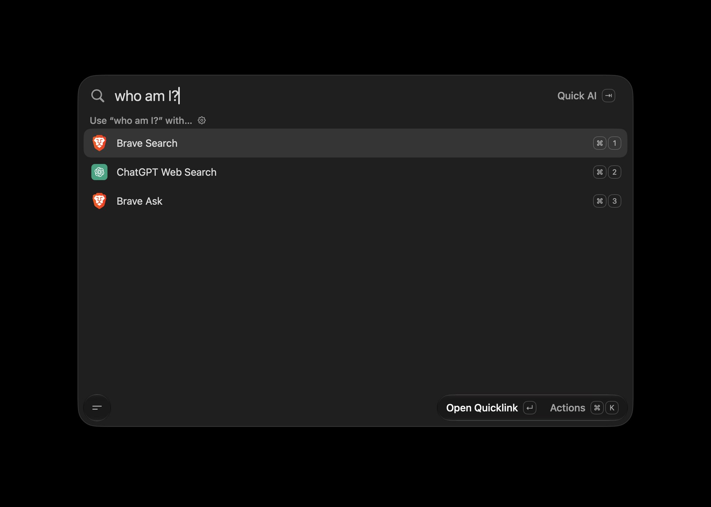

<h1 align="center">
  <a href="https://szcast.vercel.app"></a><br>
  szcast
</h1>

<p align="center">
  A native, keyboard-first macOS productivity launcher and offline dictation engine built in pure Swift.
</p>

<p align="center">
  <a href="https://szcast.vercel.app"><strong>Website</strong></a> ·
  <a href="https://github.com/sauravsz/szcast/releases/latest"><strong>Download</strong></a> ·
  <a href="docs/"><strong>Docs</strong></a> ·
  <a href="https://github.com/sauravsz/szcast/issues"><strong>Issues</strong></a>
</p>

<p align="center">
  <a href="https://github.com/sauravsz/szcast/releases/latest"><picture><source media="(prefers-color-scheme: dark)" srcset="https://shieldcn.dev/github/release/sauravsz/szcast.svg?variant=ghost&amp;font=geist-mono&amp;mode=dark&amp;label=RELEASE&amp;logo=lu:Tag&amp;valueColor=60A5FA" /></picture></a>
  <picture><source media="(prefers-color-scheme: dark)" srcset="https://shieldcn.dev/badge/MACOS-26%2B.svg?variant=ghost&amp;font=geist-mono&amp;mode=dark&amp;logo=apple" /></picture>
  <picture><source media="(prefers-color-scheme: dark)" srcset="https://shieldcn.dev/badge/SWIFT-6.svg?variant=ghost&amp;font=geist-mono&amp;mode=dark&amp;logo=swift&amp;valueColor=FB923C" /></picture>
  <a href="LICENSE"><picture><source media="(prefers-color-scheme: dark)" srcset="https://shieldcn.dev/badge/LICENSE-AGPL--3.0.svg?variant=ghost&amp;font=geist-mono&amp;mode=dark&amp;logo=lu:Scale" /></picture></a>
</p>

<p align="center">
  
</p>

## About

szcast is a lightweight, keyboard-driven launcher for macOS. It combines fast app and file searching, local AI dictation, system tweaks, and Raycast extension support into a single native binary. Built with SwiftUI and AppKit with zero Electron overhead and zero analytics.

## Installation

Download the latest `.dmg` from [Releases](https://github.com/sauravsz/szcast/releases/latest), open it, and move **szcast** to `/Applications`.

```bash
xattr -cr /Applications/szcast.app
open /Applications/szcast.app
```

## Built-In Features

### Offline Dictation & Persistent S1 Daemon
- **Persistent Local Daemon**: S1-mini normalization engine stays resident in RAM (~460 MB) for 0ms startup overhead when dictation finishes.
- **Single-Shot Paste**: Transcribes speech quietly in a floating pill, runs AI grammar cleanup, and pastes the polished text all at once.
- **Local & Cloud Engines**: Offline on-device transcription via Apple Neural Engine (Parakeet) or ultra-fast cloud fallback via Groq (`whisper-large-v3-turbo` with `openai/gpt-oss-120b`, `openai/gpt-oss-20b`, or `qwen/qwen3.8-27b`).
- **Domain Vocabulary Packs**: Custom dictionary with phonetic alias matching for tech, medical, legal, and brand terms.
- **Smart Audio Intelligence**: Automatic media ducking for Spotify and Apple Music, spoken punctuation expansion, and audio level metering.

### Liquid Glass Design & Transparency Control
- **macOS Liquid Glass UI**: Native light-bending refraction and translucent vibrancy across the launcher palette and settings window.
- **Adjustable Transparency**: User-configurable glass transparency slider (0% to 100%) with instant on/off toggle.

### Display Tweaks & Hardware LUT Calibration
- **0–100 Color Sliders**: Direct GPU gamma table manipulation (`CGSetDisplayTransferByTable`) with granular controls for Red, Green, Blue gains, Blacks, Whites, Brightness, and Contrast.
- **Quick Mirroring**: Built-in one-key display mirroring toggle.

### Built-in Productivity Suites
- **Ente Auth 2FA (`Hyper + T`)**: Instant TOTP code generation with live countdown ring tickers and automatic import from `ente_auth.txt`.
- **Finder File Actions (`Hyper + M`)**: Move or copy selected Finder files to pinned or recent destinations with automatic collision-safe renaming.
- **KeePassXC Password Manager**: Fast local vault lookups via `keepassxc-cli` with window state resumption and dedicated shortcuts (`⌘C` password, `⌘T` TOTP, `⌘B` username, `⌘U` URL).
- **DuckDuckGo Email Protection (`Hyper + D`)**: Generate and copy private `@duck.com` forwarding addresses on demand with Keychain token storage.
- **Clean Keyboard Mode**: Physical keyboard input suppression via `CGEventTap` with floating glass countdown HUD and safety release chords (Hold Escape 3s or `Ctrl + U`).
- **Open Currency Rates Calculator**: Math evaluation and currency conversions backed by free, CC0 European Central Bank daily rates without requiring an API key.

### Core Launcher Capabilities
- **Command Palette & Instant Aliases**: Fuzzy search across applications, system settings, and custom terminal scripts with alias triggers.
- **Quick Look File Previews (`⌘Y`)**: Floating native file previews in search results that follow keyboard navigation.
- **Clipboard History**: Searchable text and image clipboard buffer with favorites and quick paste.
- **Quicklinks**: Search bookmarks with automatic favicon resolution from DuckDuckGo, Google, and origin sites.
- **Window Management**: Keyboard grid snapping, multi-display window cycling, and custom layout presets.
- **Notes & Pomodoro Timer**: Markdown scratchpads with inline image attachments and menu bar focus countdowns.
- **Raycast Store Extension Compatibility**: Direct installation and native execution of community Raycast extensions.

## Acknowledgements

- **[Tinycast](https://github.com/abue-ammar/tinycast)** by Abue Ammar: The native macOS launcher foundation upon which szcast is built.
- **[EnviousWispr](https://github.com/saurabhav88/EnviousWispr)** by saurabhav88: Dictation pipeline architecture, domain vocabulary packs, and audio ducking.
- **[Raycast](https://raycast.com)**: Extension runtime model and API specifications.
- **[FreeDisplay](https://github.com/huberdf/FreeDisplay)** by huberdf: Display management and screen mirroring.
- **[gamma-control](https://github.com/Qiueyed/gamma-control)** by Qiueyed: Display gamma transfer curve mathematics and hardware LUT calculation.

Third-party licenses are documented in [NOTICE.md](NOTICE.md).

## License

szcast is open source software licensed under the [GNU AGPL v3](LICENSE). Copyright © 2026 Saurav.
