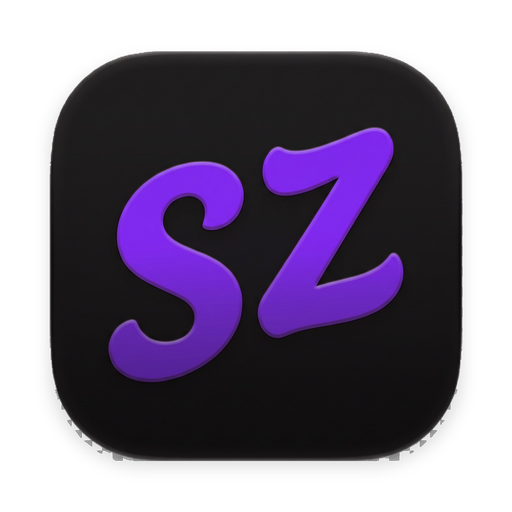

<h1 align="center">
  <a href="https://szcast.vercel.app"></a><br>
  szcast
</h1>

<p align="center">
  A native macOS launcher for everyday productivity.
</p>

<p align="center">
  <a href="https://szcast.vercel.app"><strong>Website</strong></a> ·
  <a href="#build-from-source"><strong>Build</strong></a> ·
  <a href="docs/"><strong>Docs</strong></a> ·
  <a href="https://github.com/sauravsz/szcast/issues"><strong>Issues</strong></a>
</p>

<p align="center">
  <a href="https://github.com/sauravsz/szcast"><picture><source media="(prefers-color-scheme: dark)" srcset="https://shieldcn.dev/badge/MACOS-26%2B.svg?variant=ghost&amp;font=geist-mono&amp;mode=dark&amp;logo=apple" /></picture></a>
  <picture><source media="(prefers-color-scheme: dark)" srcset="https://shieldcn.dev/badge/SWIFT-6.svg?variant=ghost&amp;font=geist-mono&amp;mode=dark&amp;logo=swift&amp;valueColor=FB923C" /></picture>
  <a href="LICENSE"><picture><source media="(prefers-color-scheme: dark)" srcset="https://shieldcn.dev/badge/LICENSE-AGPL--3.0.svg?variant=ghost&amp;font=geist-mono&amp;mode=dark&amp;logo=lu:Scale" /></picture></a>
</p>

<p align="center">
  
</p>

Szcast is a keyboard-first launcher for macOS: a command palette, file and menu search, clipboard
history, snippets, window management, notes, dictation, and a calculator. Built with SwiftUI and
AppKit — no dependencies, no Electron, no telemetry. It runs Raycast extensions, too.

No binaries are published yet — build it from source.

[Explore all features →](docs/features/)

## Build from source

Requirements: macOS 26 or newer and Xcode 27 (Swift 6, macOS 26 SDK).

```sh
git clone https://github.com/sauravsz/szcast.git
cd szcast
open szcast.xcodeproj    # scheme: Szcast, then ⌘R
```

Or from the terminal:

```sh
xcodebuild -project szcast.xcodeproj -scheme Szcast -configuration Release \
  -derivedDataPath build/DerivedData build
```

The Debug configuration builds **Szcast Dev** (`com.sauravsz.szcast.dev`) so it runs side by side
with a release install. Release builds are `com.sauravsz.szcast`.

### Local DMG

```sh
./Scripts/build-dmg.sh          # → build/Szcast-<version>.dmg
```

The script signs with the **Szcast Self-Signed** identity so macOS keeps your Accessibility grant
across rebuilds. Create that identity once — see [docs/signing.md](docs/signing.md) §1. Without it,
every rebuild resets your privacy permissions.

### Tests

```sh
./Scripts/run-tests.sh          # 113 self-contained harnesses
```

Each harness compiles the shipped sources it guards, so it needs Xcode, not just Command Line Tools.
See [docs/testing.md](docs/testing.md).

## What's in the build

- **Self-update disabled** — the build ships no update public key and no release stream exists, so
  nothing can install over itself. [docs/features/updates.md](docs/features/updates.md).
- **Static site** — the project page is `site/`, deployed to
  [szcast.vercel.app](https://szcast.vercel.app) on every push to `main`.
- **Rates come from `tinycast.dev`** — the calculator fetches exchange rates from
  `tinycast.dev/api/v1/currencies`.
- **Space opens file search** — a leading space in root search jumps straight to the file search
  screen, Alfred-style, with the term after the space already in the field. Needs File Search
  enabled; ignores the *Show in launcher* toggle.
- **⌘1…⌘0 activates the Nth visible row** — hold ⌘ to see the digits on the first ten rows; with a
  blank query they launch pinned favourites by position instead.

## Contributing

Feature requests and fixes are welcome in [this repo's issues](https://github.com/sauravsz/szcast/issues).

## License

Szcast is a fork of [Tinycast](https://github.com/abue-ammar/tinycast) by Abue Ammar, and is
licensed under the [GNU AGPL v3](LICENSE). Original copyright © 2026 Abue Ammar; third-party
material is recorded in [NOTICE.md](NOTICE.md). No affiliation with or endorsement by the
upstream author is implied.
