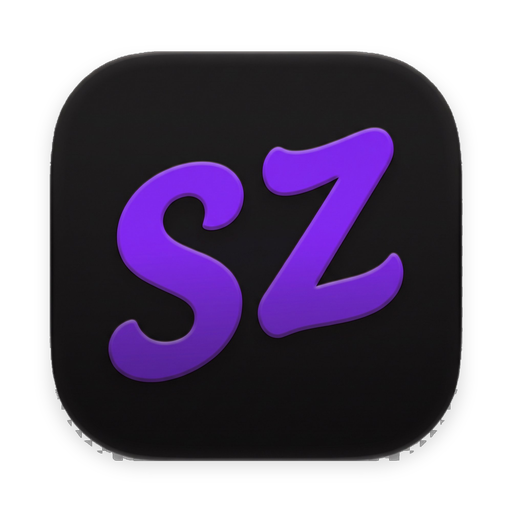
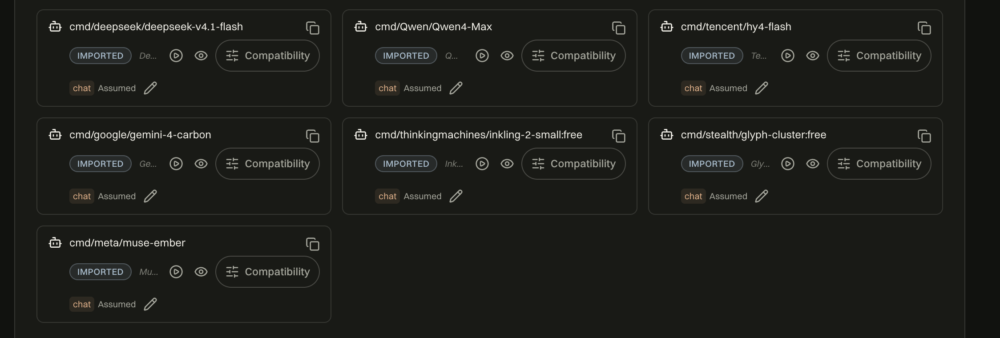

<h1 align="center">
  <a href="https://szcast.vercel.app"></a><br>
  szcast
</h1>

<p align="center">
  A native, keyboard-first macOS productivity launcher and offline dictation engine built in pure Swift.
</p>

<p align="center">
  <a href="https://szcast.vercel.app"><strong>Website</strong></a> ·
  <a href="https://github.com/sauravsz/szcast/releases/latest"><strong>Download</strong></a> ·
  <a href="docs/"><strong>Docs</strong></a> ·
  <a href="https://github.com/sauravsz/szcast/issues"><strong>Issues</strong></a>
</p>

<p align="center">
  <a href="https://github.com/sauravsz/szcast/releases/latest"><picture><source media="(prefers-color-scheme: dark)" srcset="https://shieldcn.dev/github/release/sauravsz/szcast.svg?variant=ghost&amp;font=geist-mono&amp;mode=dark&amp;label=RELEASE&amp;logo=lu:Tag&amp;valueColor=60A5FA" /></picture></a>
  <picture><source media="(prefers-color-scheme: dark)" srcset="https://shieldcn.dev/badge/MACOS-26%2B.svg?variant=ghost&amp;font=geist-mono&amp;mode=dark&amp;logo=apple" /></picture>
  <picture><source media="(prefers-color-scheme: dark)" srcset="https://shieldcn.dev/badge/SWIFT-6.svg?variant=ghost&amp;font=geist-mono&amp;mode=dark&amp;logo=swift&amp;valueColor=FB923C" /></picture>
  <a href="LICENSE"><picture><source media="(prefers-color-scheme: dark)" srcset="https://shieldcn.dev/badge/LICENSE-AGPL--3.0.svg?variant=ghost&amp;font=geist-mono&amp;mode=dark&amp;logo=lu:Scale" /></picture></a>
</p>

<p align="center">
  
</p>

## About

szcast is a lightweight, keyboard-driven launcher and offline AI dictation engine for macOS. It combines fast app searching, local speech-to-text, custom system tweaks, and Raycast extension compatibility into a single native binary. Built in Swift with zero Electron overhead and zero analytics.

## Installation

Download the latest `.dmg` from [Releases](https://github.com/sauravsz/szcast/releases/latest), open it, and move **szcast** to `/Applications`.

```bash
xattr -cr /Applications/szcast.app
open /Applications/szcast.app
```

## Key Features

### Core vs Extended Modular Architecture
- **Streamlined Settings Taxonomy**: Cleanly divides launcher capabilities into Core Features (always-ready essentials including Dictation, Notes, File Search, AI, Clipboard, Quicklinks, Snippets, Emoji & Symbols, Window Management) and Extended Features (modular power tools).
- **Extended Features Suite**: Houses System Stats (CPU, RAM, Disk, Battery, Network telemetry & individual menu bar monitors), Interactive Text Transformer, Ente Auth 2FA, KeePassXC, DuckDuckGo Mail, Display Tweaks & Gamma Control, Calendar HUD, and Clean Keyboard. Disabled by default on clean installs for minimal footprint; smart migration preserves active configurations seamlessly across updates.
- **Dynamic Sidebar & Command Gating**: Settings sidebar and launcher command routing dynamically reflect active features, keeping navigation focused and uncluttered.

### System Telemetry & Hardware Monitors (Stats Integration)
- **System Stats Dashboard & Sparklines**: Full native telemetry dashboard tracking CPU load, RAM memory pressure, Disk space, Battery health/cycles, and Network throughput (upload/download) with rolling 30-sample quadratic Bezier sparkline graphs.
- **Modular Menu Bar Items**: Individual, togglable menu bar indicators for CPU, RAM, Disk, Battery, and Network with configurable update cadences (1s, 2s, 5s, 10s).
- **Stats Parity**: Replicates exelban/stats architecture using pure Mach host statistics, IOKit power sources, and BSD system interfaces with zero daemon overhead.

### Raycast-Parity Emoji & Symbols Picker
- **Natural Language & Semantic Search**: Search emojis by Unicode name, category, and meaning with local semantic search.
- **Custom Keywords**: Assign personal keywords to any emoji or symbol via `⌘E` for instant recall, saved to local JSON storage.
- **Inline Autocomplete (`:`)**: Type `:` inside any text input (Notes, AI Chat, Snippet Editor, Quicklink Editor) for instant inline emoji completions.
- **Grid Customization & Tone Modifiers**: Configurable 6 to 10 column grid with `⌘-` / `⌘+` zoom (`⌘0` default), default skin tone picker, and contextual copy/paste with specific tone (`⌥⌘C` / `⌥⌘V`).

### Interactive Text Transformer
- **Instant Conversions**: Real-time transformation across 15+ formats: camelCase, snake_case, kebab-case, PascalCase, UPPERCASE, lowercase, Title Case, Slugify, Base64 encode/decode, URL encode/decode, SHA-256 hash, MD5, and UUID v4.
- **Side-by-Side Diff Inspector (`⌘D`)**: Toggle between stacked preview and dual-column side-by-side diff view with live metrics (characters, words, lines, byte size).
- **Clipboard & App Injection**: Instant single-key copy (`⌘C`) or paste directly to the active application (`↵`).

### Rich Developer Previews & Ergonomics
- **Clipboard Syntax Highlighting**: Automatic language detection (JSON, Swift, JavaScript, Python, SQL, Shell, HTML) with line numbers gutter and token coloring in Clipboard preview.
- **Color Swatches & Conversion Pills**: Color swatch preview with one-click interactive copy pills for Hex, RGBA, HSL, and NSColor.
- **Dynamic Footer Shortcut Strip**: Live contextual keyboard shortcut legend in the launcher footer (`⌘↵ Finder`, `⌘I Info`, `⌘. Pin`, `⌥↵ Plain Text`, `⌘D Diff`) positioned beside the primary action capsule.
- **Launcher Category Scope Filter Chips**: Horizontal filter chips (`All`, `Apps`, `Commands`, `Quicklinks`, `Snippets`, `Files`, `Actions`) for instant narrowing of search results.
- **AI Code Block Direct Injections**: 1-click "Insert at Cursor" (paste into frontmost app) and "Run in Terminal" action buttons on all AI-generated code blocks.
- **Split Action Panel (⌘K)**: Action menus structured into distinct sections (`Primary Actions`, `Shortcuts & Favorites`, `Process Control`, `Danger Zone`).
- **Tactile & Visual Feedback**: Dictation start alignment haptics and completion levelChange haptics with an animated checkmark pulse, plus Settings search target accent glow pulse.

### Extension Customization & Fast Navigation
- **Precise Command Query Routing**: Activating launcher commands cleanly strips leading command keywords before opening sub-screens, preventing query collisions when launching filtered views.
- **Centralized Extension Aliases**: Set custom aliases and global hotkeys for any installed Raycast extension command from a single view in Settings &rarr; Commands.
- **List & Submenu Shortcuts (`⌘1`..`⌘9`)**: Press `⌘1` through `⌘9` to instantly activate any item in search results, extension lists (e.g. `brew search`), and nested submenus, with dynamic keycap badges when holding `Command`.
- **Dual-Mode Snippet & Extension Icons**: Adaptive SVG icons for ChatGPT, OpenAI, and Raycast snippets that render crisply across both light and dark themes.
- **Window Geometry & Navigation Polish**: Enforced 840x600 minimum layout floor preventing sidebar truncation, 20pt unified form and settings insets, and restored visible navigation titles beside toolbar back/forward platter buttons on solid native dark chrome.

### Offline Speech Dictation & Indic Romanization
- **Dictation Insights & Speech Analytics**: Real-time Wispr Flow-style telemetry dashboard driven 100% by local dictation metrics. Track Words Per Minute (WPM), cadence meter (Top % tier), S1-mini normalization corrections, total words dictated, application-level breakdown (AI Prompts, Work Messages, Personal Messages, Documents, Emails), and interactive 16-week speech cadence streak calendar.
- **Persistent Zero-Latency Daemons**: Local S1-mini normalization engine (~460 MB RAM) and offline Parakeet v3 ASR engine pre-warmed and kept persistent via launch daemons, eliminating first-dictation cold start delays entirely.
- **Audio & Video File Transcription**: Transcribe media files directly from the menu bar using local Neural Engine or cloud Groq models, with S1 normalization and instant clipboard copy.
- **Bengali & Hindi Romanization**: Dictate in Bengali or Hindi and receive clean Latin text (Banglish & Hinglish) via local S1-mini LLM or 0ms deterministic Avro/Hunterian rules.
- **Quiet Dictation Pill & Single-Shot Paste**: Visual waveform feedback in a floating glass pill, with polished text pasted in one shot upon completion.
- **Audio Ducking & Domain Vocabulary**: Automatic media volume lowering for Spotify and Apple Music, plus built-in domain dictionaries (tech, medical, legal, brands).

### Display Tweaks & Gamma Control
- **Display Tweaks & Gamma Control**: Direct GPU gamma table controls (`CGSetDisplayTransferByTable`) with native 3-point inspector (`[ Black | Middle | White ]` tabs) featuring individual RGB and luminance sliders, 5-box checkerboard calibration targets, grayscale ramp, and RGB gradient strips matching `.gammaset` profiles for deep OLED-grade blacks without color banding.
- **Display Mirroring**: One-key hardware display mirroring toggle.

### Built-In Productivity Tools
- **Ente Auth 2FA (`Hyper + T`)**: Instant TOTP generation with live countdown tickers and auto-discovery from `ente_auth.txt`.
- **KeePassXC Manager**: Fast password vault lookups via `keepassxc-cli` with window state resumption and dedicated shortcuts (`⌘C` password, `⌘T` TOTP, `⌘B` username, `⌘U` URL).
- **DuckDuckGo Email (`Hyper + D`)**: Generate and copy private `@duck.com` alias addresses on demand.
- **Clean Keyboard Mode**: Low-level keystroke suppression via `CGEventTap` for cleaning keyboards, with floating countdown HUD and safety unlocks (Hold Escape 3s or `Ctrl + U`).
- **In-App Version Changelog**: Native Settings pane tracking release milestones, feature highlights, and architectural improvements directly inside the app.

### Core Launcher Capabilities
- **Universal Search & Aliases**: Fast fuzzy search across applications, system settings, files, and scripts.
- **Quick Look Previews (`⌘Y`)**: Floating native file preview in search results that follows arrow navigation.
- **Clipboard History**: Searchable text and image clipboard buffer with favorites and quick paste.
- **Quicklinks**: Fast bookmark launcher with automatic favicon resolution.
- **Window Snapping**: Keyboard grid snapping and multi-display window movement.
- **Raycast Store Compatibility**: Install and run community Raycast extensions natively.

## Acknowledgements

- **[Tinycast](https://github.com/abue-ammar/tinycast)** by Abue Ammar: The native macOS launcher foundation upon which szcast is built.
- **[EnviousWispr](https://github.com/saurabhav88/EnviousWispr)** by saurabhav88: Dictation pipeline architecture, domain vocabulary packs, and audio ducking.
- **[Raycast](https://raycast.com)**: Extension runtime model and API specifications.
- **[Stats](https://github.com/exelban/stats)** by Serhiy Mytrovtsiy (exelban): macOS system monitor telemetry architecture.
- **[FreeDisplay](https://github.com/huberdf/FreeDisplay)** by huberdf: Display management and screen mirroring.
- **[gamma-control](https://github.com/Qiueyed/gamma-control)** by Qiueyed: Display gamma transfer curve mathematics and hardware LUT calculation.
- **[Avro Keyboard](https://github.com/omicronlab/avro-pad)** by Mehdi Hasan Khan & OmicronLab: Phonetic Bengali romanization rules.

Third-party licenses are documented in [NOTICE.md](NOTICE.md).

## License

szcast is open source software licensed under the [GNU AGPL v3](LICENSE). Copyright © 2026 Saurav.
